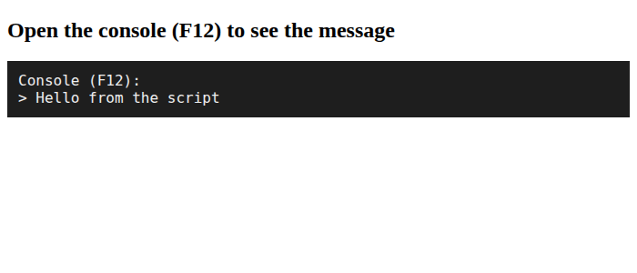
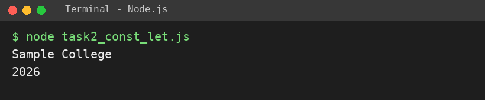
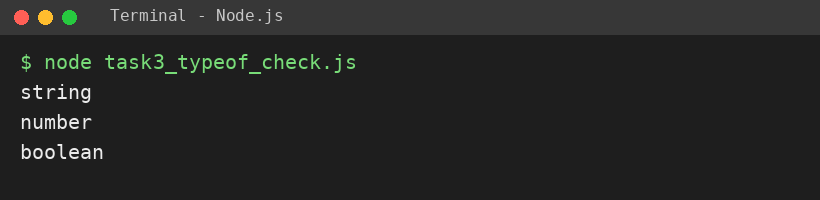

# EXPERIMENT NO. 1

**Name:** Pranay Kesarwani  |  **Roll No:** 2510303375

## 1. Experiment Title
Your First JavaScript Script

## 2. Aim
To run a script in the browser and with Node, and declare values with const and let.

## 3. Software / Tools Required
JavaScript, Node.js, VS Code, Google Chrome browser

## 4. Theory
JavaScript is a scripting language that runs in the browser (inside a <script> tag) and outside it with Node.js. console.log() prints to the console. const declares a value that cannot be reassigned; let declares a value that can change. typeof returns the data type of a value.

## 5. Algorithm / Procedure
1. Create index.html with a <script> tag inside <body> that calls console.log.
2. Open the page in the browser and check the console with F12.
3. In each task file declare const schoolName and let year, then print both.
4. Print typeof for "hello", 7 and true.
5. Run with: node each task file

## 6. Program
**task1_console_hello.html**

```html
<!-- Name: Pranay Kesarwani | Roll No: 2510303375 | Assignment: 1 -->
<!DOCTYPE html>
<html>
<head><title>Assignment 1 - Task 1</title></head>
<body>
  <h2>Open the console (F12) to see the message</h2>
  <script>
    console.log("Hello from the script");
  </script>
</body>
</html>
```

**task2_const_let.js**

```javascript
// Name: Pranay Kesarwani | Roll No: 2510303375 | Assignment: 1

// Task 2: const and let
const schoolName = "Sample College";
let year = 2026;
console.log(schoolName);
console.log(year);
```

**task3_typeof_check.js**

```javascript
// Name: Pranay Kesarwani | Roll No: 2510303375 | Assignment: 1

// Task 3: typeof
console.log(typeof "hello");
console.log(typeof 7);
console.log(typeof true);
```

## 7. Input
No user input. Values are fixed in the program: "Sample College", 2026, "hello", 7, true.

## 8. Output
**Task 1 (task1_console_hello.html)**

```
Hello from the script
```



**Task 2 (task2_const_let.js)**

```
Sample College
2026
```



**Task 3 (task3_typeof_check.js)**

```
string
number
boolean
```



## 9. Result
The experiment was performed successfully. The programs ran correctly and produced the expected output.

## 10. Viva-Voce Questions
1. **What is the difference between const and let?**  
   Ans: const cannot be reassigned, let can be.
2. **How do you open the browser console?**  
   Ans: Press F12 (or Ctrl+Shift+J) and open the Console tab.
3. **What does typeof return for 7?**  
   Ans: "number".
4. **How do you run a JS file with Node?**  
   Ans: node filename.js
