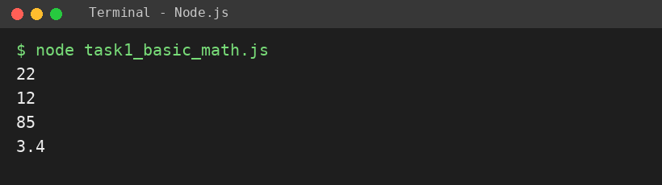
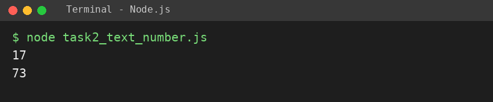
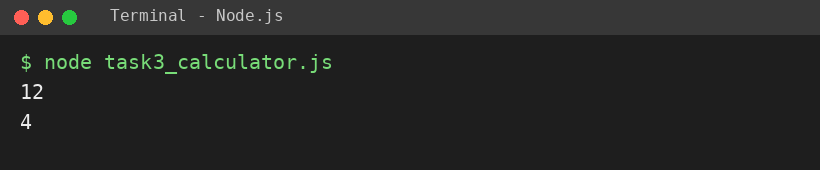

# EXPERIMENT NO. 2

**Name:** Pranay Kesarwani  |  **Roll No:** 2510303375

## 1. Experiment Title
Operators, Type Conversion and a Calculator

## 2. Aim
To use arithmetic operators, convert between text and numbers, and use if and else if to choose an operation.

## 3. Software / Tools Required
JavaScript, Node.js, VS Code

## 4. Theory
Arithmetic operators are + - * /. Number() converts text to a number and String() converts a number to text. The + operator joins text with a number (concatenation). if / else if chooses one branch based on a condition.

## 5. Algorithm / Procedure
1. Store 17 and 5; print sum, difference, product and quotient.
2. Convert "12" with Number() and add 5; convert 7 with String() and join with "3".
3. Store 8, 4 and operator "+"; use if / else if to print the sum or difference.
4. Change the operator to "-" and repeat the check.
5. Run with: node each task file

## 6. Program
**task1_basic_math.js**

```javascript
// Name: Pranay Kesarwani | Roll No: 2510303375 | Assignment: 2

const a = 17, b = 5;
console.log(a + b);
console.log(a - b);
console.log(a * b);
console.log(a / b);
```

**task2_text_number.js**

```javascript
// Name: Pranay Kesarwani | Roll No: 2510303375 | Assignment: 2

console.log(Number("12") + 5);
console.log(String(7) + "3");
```

**task3_calculator.js**

```javascript
// Name: Pranay Kesarwani | Roll No: 2510303375 | Assignment: 2

const x = 8, y = 4;
let op = "+";
if (op === "+") {
  console.log(x + y);
} else if (op === "-") {
  console.log(x - y);
}

op = "-";
if (op === "+") {
  console.log(x + y);
} else if (op === "-") {
  console.log(x - y);
}
```

## 7. Input
17 and 5; "12" and 5; 7 and "3"; 8, 4 with operators + and -.

## 8. Output
**Task 1 (task1_basic_math.js)**

```
22
12
85
3.4
```



**Task 2 (task2_text_number.js)**

```
17
73
```



**Task 3 (task3_calculator.js)**

```
12
4
```



## 9. Result
The experiment was performed successfully. The programs ran correctly and produced the expected output.

## 10. Viva-Voce Questions
1. **What is type conversion?**  
   Ans: Changing a value from one type to another, e.g. text to number.
2. **What does 7 + "3" give?**  
   Ans: "73" - the number is converted to text and joined.
3. **Why use else if?**  
   Ans: To test another condition when the first one is false.
4. **What is the result of 17 / 5?**  
   Ans: 3.4
