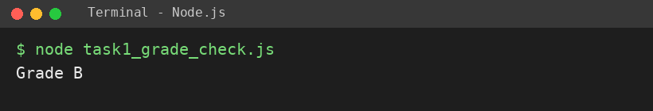
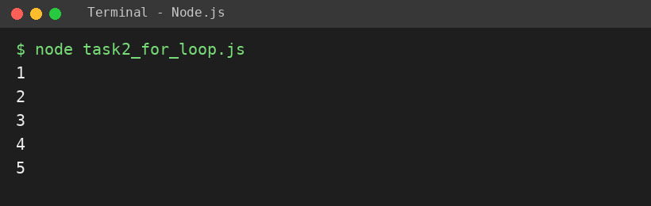
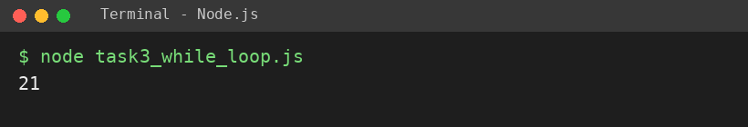

# EXPERIMENT NO. 3

**Name:** Pranay Kesarwani  |  **Roll No:** 2510303375

## 1. Experiment Title
Conditions and Loops

## 2. Aim
To choose between cases with if, else if and else, and repeat work with a for loop and a while loop.

## 3. Software / Tools Required
JavaScript, Node.js, VS Code

## 4. Theory
if / else if / else runs only one matching branch. A for loop repeats a fixed number of times (init; condition; update). A while loop repeats as long as its condition is true, so the variable inside must change to avoid an infinite loop.

## 5. Algorithm / Procedure
1. Store marks = 72; print Grade A for 75+, Grade B for 60+, else Grade C.
2. Use a for loop from 1 to 5 and print each number.
3. Use a while loop: add 1, 2, 3 ... to total until total > 20; print the total.
4. Run with: node each task file

## 6. Program
**task1_grade_check.js**

```javascript
// Name: Pranay Kesarwani | Roll No: 2510303375 | Assignment: 3

const marks = 72;
if (marks >= 75) {
  console.log("Grade A");
} else if (marks >= 60) {
  console.log("Grade B");
} else {
  console.log("Grade C");
}
```

**task2_for_loop.js**

```javascript
// Name: Pranay Kesarwani | Roll No: 2510303375 | Assignment: 3

for (let i = 1; i <= 5; i++) {
  console.log(i);
}
```

**task3_while_loop.js**

```javascript
// Name: Pranay Kesarwani | Roll No: 2510303375 | Assignment: 3

let total = 0;
let n = 1;
while (total <= 20) {
  total += n;
  n++;
}
console.log(total);
```

## 7. Input
marks = 72.

## 8. Output
**Task 1 (task1_grade_check.js)**

```
Grade B
```



**Task 2 (task2_for_loop.js)**

```
1
2
3
4
5
```



**Task 3 (task3_while_loop.js)**

```
21
```



## 9. Result
The experiment was performed successfully. The programs ran correctly and produced the expected output.

## 10. Viva-Voce Questions
1. **Difference between for and while loop?**  
   Ans: for is used when the count is known; while repeats until a condition becomes false.
2. **What is an infinite loop?**  
   Ans: A loop whose condition never becomes false.
3. **Which grade is printed for 72 marks?**  
   Ans: Grade B.
4. **What does i++ do?**  
   Ans: Increases i by 1.
