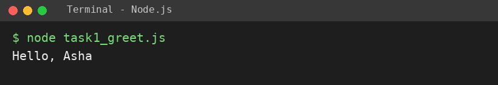
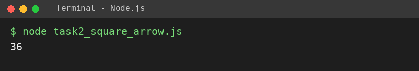
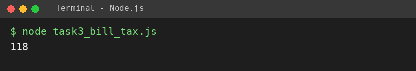

# EXPERIMENT NO. 4

**Name:** Pranay Kesarwani  |  **Roll No:** 2510303375

## 1. Experiment Title
Writing Functions

## 2. Aim
To write a function with a return value, an arrow function, and a default parameter.

## 3. Software / Tools Required
JavaScript, Node.js, VS Code

## 4. Theory
A function is a reusable block of code. return sends a value back. An arrow function is a shorter syntax: (x) => x * x. A default parameter gives a value when the argument is not passed.

## 5. Algorithm / Procedure
1. Write greet(name) that returns "Hello, " + name and print greet("Asha").
2. Write arrow function square and print square(6).
3. Write billWithTax(amount, taxRate = 0.18) and print billWithTax(100).
4. Run with: node each task file

## 6. Program
**task1_greet.js**

```javascript
// Name: Pranay Kesarwani | Roll No: 2510303375 | Assignment: 4

function greet(name) {
  return "Hello, " + name;
}
console.log(greet("Asha"));
```

**task2_square_arrow.js**

```javascript
// Name: Pranay Kesarwani | Roll No: 2510303375 | Assignment: 4

const square = (n) => n * n;
console.log(square(6));
```

**task3_bill_tax.js**

```javascript
// Name: Pranay Kesarwani | Roll No: 2510303375 | Assignment: 4

function billWithTax(amount, taxRate = 0.18) {
  return amount + amount * taxRate;
}
console.log(billWithTax(100));
```

## 7. Input
"Asha"; 6; amount = 100 (tax rate not given).

## 8. Output
**Task 1 (task1_greet.js)**

```
Hello, Asha
```



**Task 2 (task2_square_arrow.js)**

```
36
```



**Task 3 (task3_bill_tax.js)**

```
118
```



## 9. Result
The experiment was performed successfully. The programs ran correctly and produced the expected output.

## 10. Viva-Voce Questions
1. **What is a default parameter?**  
   Ans: A value used when the argument is not given.
2. **What is an arrow function?**  
   Ans: A short function syntax using =>.
3. **What does return do?**  
   Ans: Sends a value back and stops the function.
4. **What is billWithTax(100)?**  
   Ans: 118.
