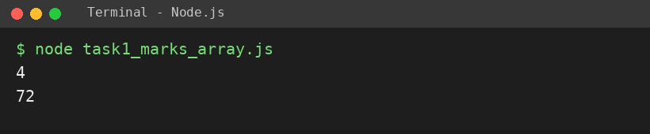
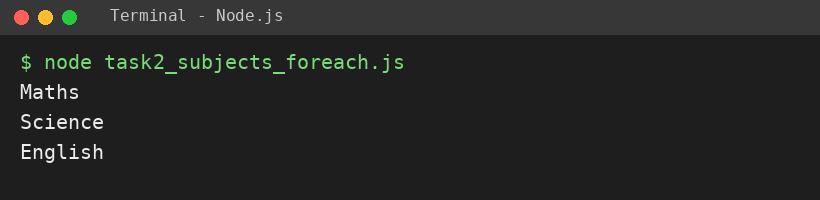
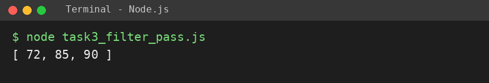
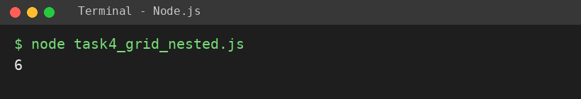

# EXPERIMENT NO. 5

**Name:** Pranay Kesarwani  |  **Roll No:** 2510303375

## 1. Experiment Title
Arrays, Array Methods and Nested Arrays

## 2. Aim
To create an array, read its items, use forEach and filter, and read a value from an array inside an array.

## 3. Software / Tools Required
JavaScript, Node.js, VS Code

## 4. Theory
An array stores many values in order; indexes start at 0 and length gives the count. forEach runs a function for each item. filter returns a new array with only the items that pass a test. A nested array (array in array) is read as grid[row][column].

## 5. Algorithm / Procedure
1. Create marks array; print length and first item.
2. Create subjects array; use forEach to print each.
3. Create marks array and use filter (>= 60); print the new array.
4. Create grid = [[1,2,3],[4,5,6]]; print grid[1][2].
5. Run with: node each task file

## 6. Program
**task1_marks_array.js**

```javascript
// Name: Pranay Kesarwani | Roll No: 2510303375 | Assignment: 5

const marks = [72, 85, 64, 90];
console.log(marks.length);
console.log(marks[0]);
```

**task2_subjects_foreach.js**

```javascript
// Name: Pranay Kesarwani | Roll No: 2510303375 | Assignment: 5

const subjects = ["Maths", "Science", "English"];
subjects.forEach((s) => console.log(s));
```

**task3_filter_pass.js**

```javascript
// Name: Pranay Kesarwani | Roll No: 2510303375 | Assignment: 5

const m = [72, 85, 45, 90];
const passed = m.filter((x) => x >= 60);
console.log(passed);
```

**task4_grid_nested.js**

```javascript
// Name: Pranay Kesarwani | Roll No: 2510303375 | Assignment: 5

const grid = [[1, 2, 3], [4, 5, 6]];
console.log(grid[1][2]);
```

## 7. Input
[72, 85, 64, 90]; ["Maths", "Science", "English"]; [72, 85, 45, 90]; [[1,2,3],[4,5,6]].

## 8. Output
**Task 1 (task1_marks_array.js)**

```
4
72
```



**Task 2 (task2_subjects_foreach.js)**

```
Maths
Science
English
```



**Task 3 (task3_filter_pass.js)**

```
[ 72, 85, 90 ]
```



**Task 4 (task4_grid_nested.js)**

```
6
```



## 9. Result
The experiment was performed successfully. The programs ran correctly and produced the expected output.

## 10. Viva-Voce Questions
1. **What is the index of the first item?**  
   Ans: 0.
2. **What does filter return?**  
   Ans: A new array of items that pass the test.
3. **How is row 2, column 3 read?**  
   Ans: grid[1][2].
4. **Difference between forEach and filter?**  
   Ans: forEach just runs code for each item; filter builds a new array.
