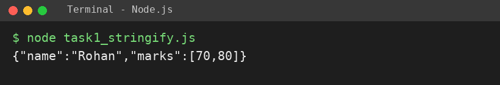
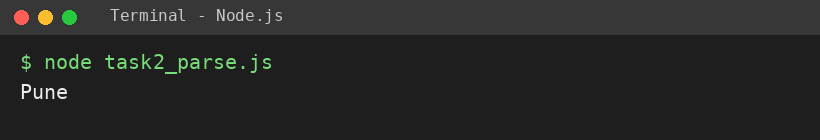
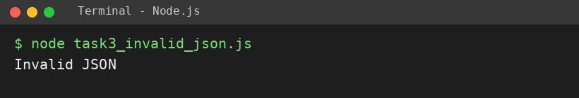

# EXPERIMENT NO. 6

**Name:** Pranay Kesarwani  |  **Roll No:** 2510303375

## 1. Experiment Title
JSON Text

## 2. Aim
To convert an object to JSON text, convert JSON text back to an object, and catch invalid JSON.

## 3. Software / Tools Required
JavaScript, Node.js, VS Code

## 4. Theory
JSON is a text format for data. JSON.stringify() converts an object to JSON text; JSON.parse() converts JSON text to an object. Invalid JSON makes JSON.parse throw an error, which can be handled with try / catch.

## 5. Algorithm / Procedure
1. Create object {name:"Rohan", marks:[70,80]} and print JSON.stringify of it.
2. Parse the text {"city":"Pune","pin":411001} and print city.
3. Put {name: Rohan} in a string, call JSON.parse inside try, print Invalid JSON in catch.
4. Run with: node each task file

## 6. Program
**task1_stringify.js**

```javascript
// Name: Pranay Kesarwani | Roll No: 2510303375 | Assignment: 6

const student = { name: "Rohan", marks: [70, 80] };
const text = JSON.stringify(student);
console.log(text);
```

**task2_parse.js**

```javascript
// Name: Pranay Kesarwani | Roll No: 2510303375 | Assignment: 6

const data = '{"city":"Pune","pin":411001}';
const obj = JSON.parse(data);
console.log(obj.city);
```

**task3_invalid_json.js**

```javascript
// Name: Pranay Kesarwani | Roll No: 2510303375 | Assignment: 6

const bad = "{name: Rohan}";
try {
  JSON.parse(bad);
} catch (e) {
  console.log("Invalid JSON");
}
```

## 7. Input
Object with name Rohan and marks 70, 80; JSON text with city Pune; invalid text {name: Rohan}.

## 8. Output
**Task 1 (task1_stringify.js)**

```
{"name":"Rohan","marks":[70,80]}
```



**Task 2 (task2_parse.js)**

```
Pune
```



**Task 3 (task3_invalid_json.js)**

```
Invalid JSON
```



## 9. Result
The experiment was performed successfully. The programs ran correctly and produced the expected output.

## 10. Viva-Voce Questions
1. **What is JSON?**  
   Ans: A text format to store and exchange data.
2. **Difference between stringify and parse?**  
   Ans: stringify: object to text; parse: text to object.
3. **Why is {name: Rohan} invalid JSON?**  
   Ans: Keys and string values must be in double quotes.
4. **What is try / catch for?**  
   Ans: To handle errors without stopping the program.
