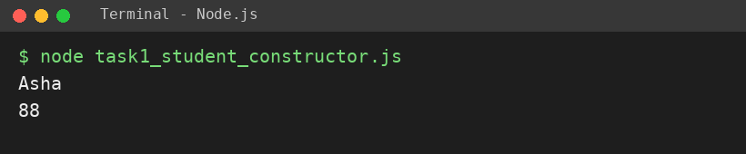
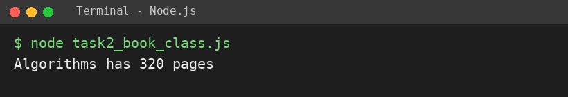
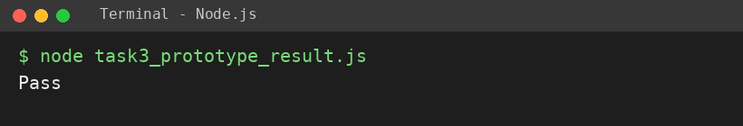

# EXPERIMENT NO. 7

**Name:** Pranay Kesarwani  |  **Roll No:** 2510303375

## 1. Experiment Title
Constructor Functions and Classes

## 2. Aim
To create objects with a constructor function and with an ES6 class, and add a method through the prototype.

## 3. Software / Tools Required
JavaScript, Node.js, VS Code

## 4. Theory
A constructor function builds objects using the new keyword and this. An ES6 class does the same with cleaner syntax (constructor + methods). Methods added to Constructor.prototype are shared by all objects created from it.

## 5. Algorithm / Procedure
1. Create constructor function Student(name, marks); create Asha (88); print name and marks.
2. Create class Book(title, pages) with summary(); create Algorithms (320) and print summary.
3. Add result() to Student.prototype (Pass for 40+, else Fail); print Asha's result.
4. Run with: node each task file

## 6. Program
**task1_student_constructor.js**

```javascript
// Name: Pranay Kesarwani | Roll No: 2510303375 | Assignment: 7

function Student(name, marks) {
  this.name = name;
  this.marks = marks;
}
const s1 = new Student("Asha", 88);
console.log(s1.name);
console.log(s1.marks);
```

**task2_book_class.js**

```javascript
// Name: Pranay Kesarwani | Roll No: 2510303375 | Assignment: 7

class Book {
  constructor(title, pages) {
    this.title = title;
    this.pages = pages;
  }
  summary() {
    return this.title + " has " + this.pages + " pages";
  }
}
const b = new Book("Algorithms", 320);
console.log(b.summary());
```

**task3_prototype_result.js**

```javascript
// Name: Pranay Kesarwani | Roll No: 2510303375 | Assignment: 7

function Student(name, marks) {
  this.name = name;
  this.marks = marks;
}
Student.prototype.result = function () {
  return this.marks >= 40 ? "Pass" : "Fail";
};
const s2 = new Student("Asha", 88);
console.log(s2.result());
```

## 7. Input
Student Asha, marks 88; Book Algorithms, 320 pages.

## 8. Output
**Task 1 (task1_student_constructor.js)**

```
Asha
88
```



**Task 2 (task2_book_class.js)**

```
Algorithms has 320 pages
```



**Task 3 (task3_prototype_result.js)**

```
Pass
```



## 9. Result
The experiment was performed successfully. The programs ran correctly and produced the expected output.

## 10. Viva-Voce Questions
1. **What does the new keyword do?**  
   Ans: Creates a new object and runs the constructor on it.
2. **Why add methods to the prototype?**  
   Ans: All objects share one copy, saving memory.
3. **What is a class in ES6?**  
   Ans: A cleaner syntax for constructor functions.
4. **What is this?**  
   Ans: The object being created / the current object.
