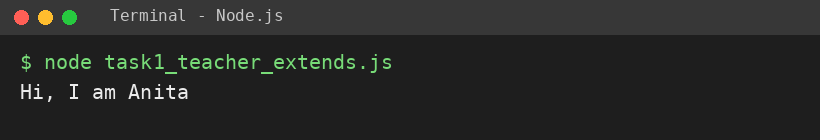
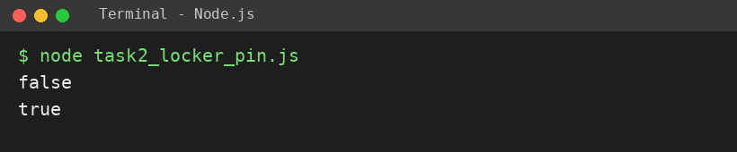
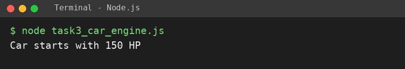

# EXPERIMENT NO. 8

**Name:** Pranay Kesarwani  |  **Roll No:** 2510303375

## 1. Experiment Title
Inheritance, Methods and Composition

## 2. Aim
To use extends to make a child class, write a method that checks a value, and place one object inside another.

## 3. Software / Tools Required
JavaScript, Node.js, VS Code

## 4. Theory
Inheritance: a child class (extends) gets the properties and methods of a parent class; super() calls the parent constructor. Composition: one object holds another object as a property (a Car has an Engine).

## 5. Algorithm / Procedure
1. Create class Person with greet(); class Teacher extends Person with subject; print Anita's greeting.
2. Create class Locker with pin and checkPin(n); print checkPin(1111) and checkPin(1234).
3. Create class Engine(power) and class Car that creates an Engine; start() returns the message; print it.
4. Run with: node each task file

## 6. Program
**task1_teacher_extends.js**

```javascript
// Name: Pranay Kesarwani | Roll No: 2510303375 | Assignment: 8

class Person {
  constructor(name) {
    this.name = name;
  }
  greet() {
    return "Hi, I am " + this.name;
  }
}
class Teacher extends Person {
  constructor(name, subject) {
    super(name);
    this.subject = subject;
  }
}
const t = new Teacher("Anita", "Maths");
console.log(t.greet());
```

**task2_locker_pin.js**

```javascript
// Name: Pranay Kesarwani | Roll No: 2510303375 | Assignment: 8

class Locker {
  constructor(pin) {
    this.pin = pin;
  }
  checkPin(n) {
    return n === this.pin;
  }
}
const locker = new Locker(1234);
console.log(locker.checkPin(1111));
console.log(locker.checkPin(1234));
```

**task3_car_engine.js**

```javascript
// Name: Pranay Kesarwani | Roll No: 2510303375 | Assignment: 8

class Engine {
  constructor(power) {
    this.power = power;
  }
}
class Car {
  constructor(power) {
    this.engine = new Engine(power);
  }
  start() {
    return "Car starts with " + this.engine.power + " HP";
  }
}
const car = new Car(150);
console.log(car.start());
```

## 7. Input
Teacher Anita (Maths); Locker pin 1234 tested with 1111 and 1234; Car with power 150.

## 8. Output
**Task 1 (task1_teacher_extends.js)**

```
Hi, I am Anita
```



**Task 2 (task2_locker_pin.js)**

```
false
true
```



**Task 3 (task3_car_engine.js)**

```
Car starts with 150 HP
```



## 9. Result
The experiment was performed successfully. The programs ran correctly and produced the expected output.

## 10. Viva-Voce Questions
1. **What does extends do?**  
   Ans: Makes a class inherit from another class.
2. **What is super()?**  
   Ans: Calls the parent class constructor.
3. **What is composition?**  
   Ans: Putting one object inside another (has-a relation).
4. **Inheritance vs composition?**  
   Ans: Inheritance is is-a; composition is has-a.
