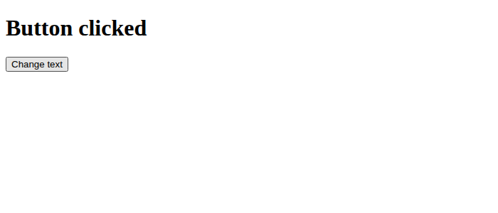
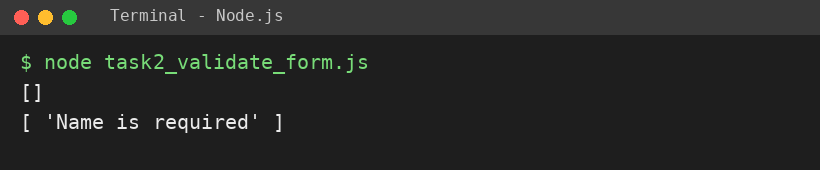
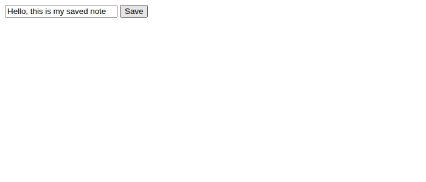
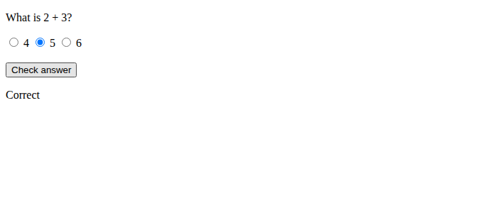

# EXPERIMENT NO. 9

**Name:** Pranay Kesarwani  |  **Roll No:** 2510303375

## 1. Experiment Title
DOM, Validation, Storage and Quiz

## 2. Aim
To change a page with a click, check form values in code, save text in local storage, and build a small quiz.

## 3. Software / Tools Required
JavaScript, Node.js, VS Code, Google Chrome browser

## 4. Theory
The DOM represents the page as objects; document.getElementById selects an element and addEventListener handles events. Validation checks input in code. localStorage stores key/value text in the browser and survives page reload. Radio buttons let the user choose one option.

## 5. Algorithm / Procedure
1. task1.html: heading + button; on click change heading text.
2. each task file: validateForm(name) returns an errors array; print for "Asha" and "" (run with node).
3. task3.html: text box + Save button; save to localStorage key note; on load fill the box.
4. task4.html: question with 3 radio buttons; Check answer shows Correct for 5, else Try again.
5. Open the HTML files in Chrome; run each task file with node.

## 6. Program
**task1_change_heading.html**

```html
<!-- Name: Pranay Kesarwani | Roll No: 2510303375 | Assignment: 9 -->
<!DOCTYPE html>
<html>
<head><title>Assignment 9 - Task 1</title></head>
<body>
  <h1 id="heading">Welcome</h1>
  <button id="btn">Change text</button>
  <script>
    document.getElementById("btn").addEventListener("click", function () {
      document.getElementById("heading").textContent = "Button clicked";
    });
  </script>
</body>
</html>
```

**task2_validate_form.js**

```javascript
// Name: Pranay Kesarwani | Roll No: 2510303375 | Assignment: 9

// ---------- Task 2 ----------
function validateForm(name) {
  const errors = [];
  if (!name || name.trim() === "") {
    errors.push("Name is required");
  }
  return errors;
}
console.log(validateForm("Asha"));
console.log(validateForm(""));
```

**task3_save_note.html**

```html
<!-- Name: Pranay Kesarwani | Roll No: 2510303375 | Assignment: 9 -->
<!DOCTYPE html>
<html>
<head><title>Assignment 9 - Task 3</title></head>
<body>
  <input type="text" id="note" placeholder="Type a note">
  <button id="save">Save</button>
  <script>
    const box = document.getElementById("note");
    box.value = localStorage.getItem("note") || "";
    document.getElementById("save").addEventListener("click", function () {
      localStorage.setItem("note", box.value);
    });
  </script>
</body>
</html>
```

**task4_quiz.html**

```html
<!-- Name: Pranay Kesarwani | Roll No: 2510303375 | Assignment: 9 -->
<!DOCTYPE html>
<html>
<head><title>Assignment 9 - Task 4</title></head>
<body>
  <p>What is 2 + 3?</p>
  <label><input type="radio" name="ans" value="4"> 4</label>
  <label><input type="radio" name="ans" value="5"> 5</label>
  <label><input type="radio" name="ans" value="6"> 6</label>
  <br><br>
  <button id="check">Check answer</button>
  <p id="result"></p>
  <script>
    document.getElementById("check").addEventListener("click", function () {
      const chosen = document.querySelector('input[name="ans"]:checked');
      document.getElementById("result").textContent =
        chosen && chosen.value === "5" ? "Correct" : "Try again";
    });
  </script>
</body>
</html>
```

## 7. Input
Click on button; names "Asha" and ""; text typed in the box; radio choice 4 / 5 / 6.

## 8. Output
**Task 1 (task1_change_heading.html)**

```
Heading changes from Welcome to Button clicked after the click (see screenshot).
```



**Task 2 (task2_validate_form.js)**

```
[]
[ 'Name is required' ]
```



**Task 3 (task3_save_note.html)**

```
The saved note is shown again in the box after reload (see screenshot).
```



**Task 4 (task4_quiz.html)**

```
Choosing 5 shows Correct; any other choice shows Try again (see screenshot).
```



## 9. Result
The experiment was performed successfully. The programs ran correctly and produced the expected output.

## 10. Viva-Voce Questions
1. **What is the DOM?**  
   Ans: The page represented as objects that JavaScript can change.
2. **What is localStorage?**  
   Ans: Browser storage of key/value text that stays after reload.
3. **How do you handle a click?**  
   Ans: addEventListener("click", function).
4. **How do you read the chosen radio button?**  
   Ans: document.querySelector('input[name="ans"]:checked').value
