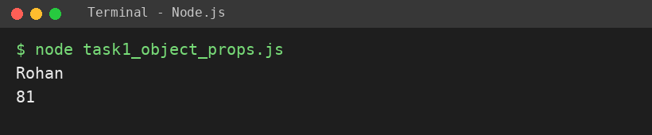
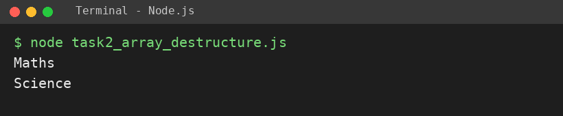
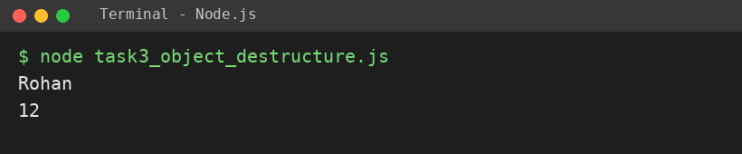

# EXPERIMENT NO. 10

**Name:** Pranay Kesarwani  |  **Roll No:** 2510303375

## 1. Experiment Title
Objects and Destructuring

## 2. Aim
To create an object, read and change its properties, and take values out of an array and an object with destructuring.

## 3. Software / Tools Required
JavaScript, Node.js, VS Code

## 4. Theory
An object stores data as key: value pairs; properties are read with dot notation and can be changed by assignment. Destructuring takes values out of an array by position ([a, b] = arr) or out of an object by name ({name, roll} = obj).

## 5. Algorithm / Procedure
1. Create student object; print name; change marks to 81; print marks.
2. Create subjects array; destructure first two into first and second; print them.
3. Create student object; destructure name and roll; print them.
4. Run with: node each task file

## 6. Program
**task1_object_props.js**

```javascript
// Name: Pranay Kesarwani | Roll No: 2510303375 | Assignment: 10

const student = { name: "Rohan", roll: 12, marks: 78 };
console.log(student.name);
student.marks = 81;
console.log(student.marks);
```

**task2_array_destructure.js**

```javascript
// Name: Pranay Kesarwani | Roll No: 2510303375 | Assignment: 10

const subjects = ["Maths", "Science", "English"];
const [first, second] = subjects;
console.log(first);
console.log(second);
```

**task3_object_destructure.js**

```javascript
// Name: Pranay Kesarwani | Roll No: 2510303375 | Assignment: 10

const st = { name: "Rohan", roll: 12, marks: 81 };
const { name, roll } = st;
console.log(name);
console.log(roll);
```

## 7. Input
student {name: Rohan, roll: 12, marks: 78 then 81}; ["Maths", "Science", "English"].

## 8. Output
**Task 1 (task1_object_props.js)**

```
Rohan
81
```



**Task 2 (task2_array_destructure.js)**

```
Maths
Science
```



**Task 3 (task3_object_destructure.js)**

```
Rohan
12
```



## 9. Result
The experiment was performed successfully. The programs ran correctly and produced the expected output.

## 10. Viva-Voce Questions
1. **What is destructuring?**  
   Ans: Taking values out of arrays/objects into variables.
2. **How is a property changed?**  
   Ans: obj.property = newValue.
3. **Array vs object destructuring?**  
   Ans: Array uses position [ ]; object uses names { }.
4. **Can const objects be changed?**  
   Ans: Yes, properties can change; the variable cannot be reassigned.
