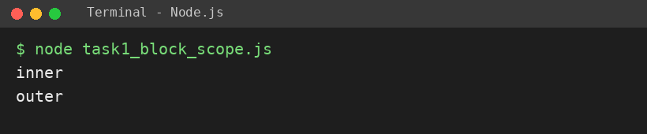
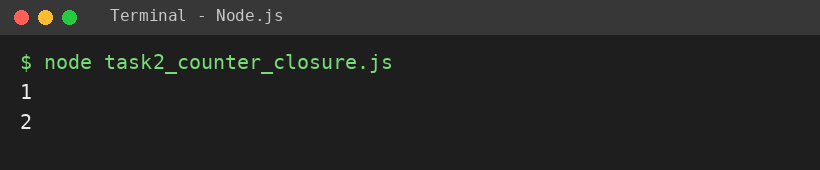
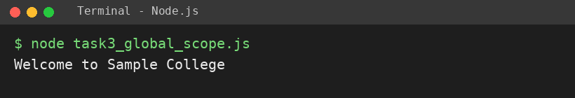

# EXPERIMENT NO. 11

**Name:** Pranay Kesarwani  |  **Roll No:** 2510303375

## 1. Experiment Title
Scope and Closures

## 2. Aim
To explain block scope and global scope, and use a function that returns a function that keeps a value between calls.

## 3. Software / Tools Required
JavaScript, Node.js, VS Code

## 4. Theory
let and const are block scoped: a variable declared inside { } is separate from one with the same name outside. A global variable can be used inside functions. A closure is an inner function that remembers variables of the outer function even after it has returned.

## 5. Algorithm / Procedure
1. Declare level = "outer"; inside a block declare level = "inner" and print; print level after the block.
2. Write makeCounter() with count = 0 returning a function that increments and returns count; call it twice.
3. Declare global school; function showSchool prints Welcome to + school; call it.
4. Run with: node each task file

## 6. Program
**task1_block_scope.js**

```javascript
// Name: Pranay Kesarwani | Roll No: 2510303375 | Assignment: 11

let level = "outer";
{
  let level = "inner";
  console.log(level);
}
console.log(level);
```

**task2_counter_closure.js**

```javascript
// Name: Pranay Kesarwani | Roll No: 2510303375 | Assignment: 11

function makeCounter() {
  let count = 0;
  return function () {
    count++;
    return count;
  };
}
const counter = makeCounter();
console.log(counter());
console.log(counter());
```

**task3_global_scope.js**

```javascript
// Name: Pranay Kesarwani | Roll No: 2510303375 | Assignment: 11

const school = "Sample College";
function showSchool() {
  console.log("Welcome to " + school);
}
showSchool();
```

## 7. Input
No input. level = outer / inner; school = Sample College.

## 8. Output
**Task 1 (task1_block_scope.js)**

```
inner
outer
```



**Task 2 (task2_counter_closure.js)**

```
1
2
```



**Task 3 (task3_global_scope.js)**

```
Welcome to Sample College
```



## 9. Result
The experiment was performed successfully. The programs ran correctly and produced the expected output.

## 10. Viva-Voce Questions
1. **What is block scope?**  
   Ans: A variable exists only inside the { } where it is declared (let / const).
2. **What is a closure?**  
   Ans: A function that remembers variables from its outer function.
3. **What is a global variable?**  
   Ans: A variable declared outside any function, usable everywhere.
4. **Why does the counter print 1 then 2?**  
   Ans: count is kept alive by the closure between calls.
