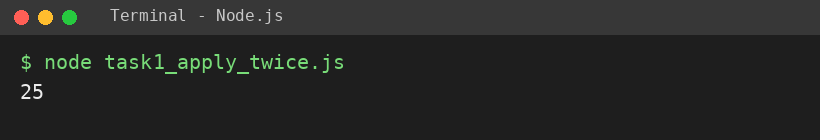
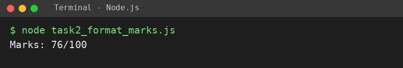
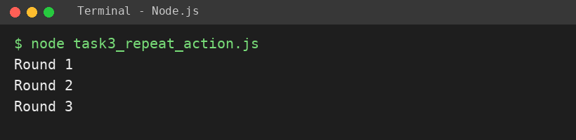

# EXPERIMENT NO. 12

**Name:** Pranay Kesarwani  |  **Roll No:** 2510303375

## 1. Experiment Title
Callbacks and Higher-Order Functions

## 2. Aim
To pass a function as an argument to another function and call it.

## 3. Software / Tools Required
JavaScript, Node.js, VS Code

## 4. Theory
In JavaScript functions are values. A callback is a function passed to another function to be called later. A function that takes or returns another function is a higher-order function.

## 5. Algorithm / Procedure
1. Write applyTwice(fn, value) = fn(fn(value)); with addTen print applyTwice(addTen, 5).
2. Write formatMarks(marks, callback); pass an arrow function that returns "Marks: " + marks + "/100".
3. Write repeatAction(times, action) calling action(round) for rounds 1..times; print Round n.
4. Run with: node each task file

## 6. Program
**task1_apply_twice.js**

```javascript
// Name: Pranay Kesarwani | Roll No: 2510303375 | Assignment: 12

function applyTwice(fn, value) {
  return fn(fn(value));
}
function addTen(n) {
  return n + 10;
}
console.log(applyTwice(addTen, 5));
```

**task2_format_marks.js**

```javascript
// Name: Pranay Kesarwani | Roll No: 2510303375 | Assignment: 12

function formatMarks(marks, callback) {
  return callback(marks);
}
console.log(formatMarks(76, (m) => "Marks: " + m + "/100"));
```

**task3_repeat_action.js**

```javascript
// Name: Pranay Kesarwani | Roll No: 2510303375 | Assignment: 12

function repeatAction(times, action) {
  for (let round = 1; round <= times; round++) {
    action(round);
  }
}
repeatAction(3, (r) => console.log("Round " + r));
```

## 7. Input
5 with addTen; marks 76; times = 3.

## 8. Output
**Task 1 (task1_apply_twice.js)**

```
25
```



**Task 2 (task2_format_marks.js)**

```
Marks: 76/100
```



**Task 3 (task3_repeat_action.js)**

```
Round 1
Round 2
Round 3
```



## 9. Result
The experiment was performed successfully. The programs ran correctly and produced the expected output.

## 10. Viva-Voce Questions
1. **What is a callback?**  
   Ans: A function passed as an argument to be called later.
2. **What is a higher-order function?**  
   Ans: A function that takes or returns another function.
3. **What is applyTwice(addTen, 5)?**  
   Ans: 25.
4. **Why can functions be passed as values?**  
   Ans: Functions are first-class values in JavaScript.
