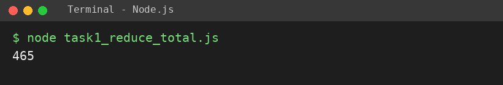
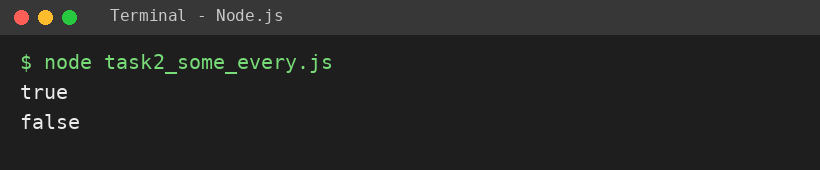
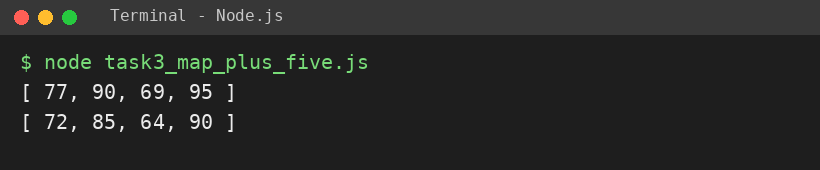

# EXPERIMENT NO. 13

**Name:** Pranay Kesarwani  |  **Roll No:** 2510303375

## 1. Experiment Title
Reduce, Some, Every and Map

## 2. Aim
To use reduce, some, every and map on arrays, and keep the original array unchanged.

## 3. Software / Tools Required
JavaScript, Node.js, VS Code

## 4. Theory
reduce combines all items into one value (e.g. a total). some returns true if at least one item passes a test; every returns true only if all items pass. map returns a new array by changing every item; the original array stays unchanged.

## 5. Algorithm / Procedure
1. Use reduce((sum, p) => sum + p, 0) on the prices and print the total.
2. Use some for mark < 40 and every for mark >= 35; print both results.
3. Use map to add 5 to every mark; print the new array and then the original.
4. Run with: node each task file

## 6. Program
**task1_reduce_total.js**

```javascript
// Name: Pranay Kesarwani | Roll No: 2510303375 | Assignment: 13

const prices = [120, 45, 300];
const total = prices.reduce((sum, p) => sum + p, 0);
console.log(total);
```

**task2_some_every.js**

```javascript
// Name: Pranay Kesarwani | Roll No: 2510303375 | Assignment: 13

const marks = [72, 85, 30, 90];
console.log(marks.some((m) => m < 40));
console.log(marks.every((m) => m >= 35));
```

**task3_map_plus_five.js**

```javascript
// Name: Pranay Kesarwani | Roll No: 2510303375 | Assignment: 13

const original = [72, 85, 64, 90];
const plusFive = original.map((m) => m + 5);
console.log(plusFive);
console.log(original);
```

## 7. Input
[120, 45, 300]; [72, 85, 30, 90]; [72, 85, 64, 90].

## 8. Output
**Task 1 (task1_reduce_total.js)**

```
465
```



**Task 2 (task2_some_every.js)**

```
true
false
```



**Task 3 (task3_map_plus_five.js)**

```
[ 77, 90, 69, 95 ]
[ 72, 85, 64, 90 ]
```



## 9. Result
The experiment was performed successfully. The programs ran correctly and produced the expected output.

## 10. Viva-Voce Questions
1. **What does reduce do?**  
   Ans: Combines all items of an array into a single value.
2. **Difference between some and every?**  
   Ans: some: at least one passes; every: all must pass.
3. **Does map change the original array?**  
   Ans: No, it returns a new array.
4. **What is the initial value in reduce?**  
   Ans: The starting value of the accumulator (0 here).
