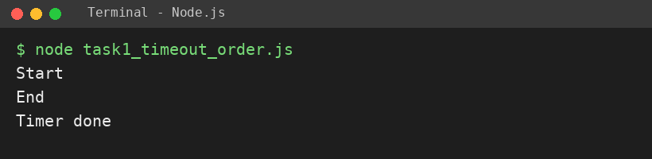
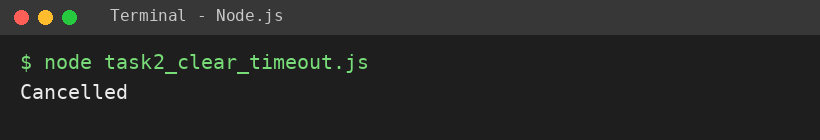
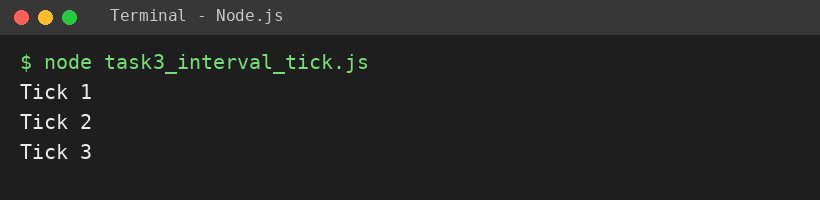

# EXPERIMENT NO. 14

**Name:** Pranay Kesarwani  |  **Roll No:** 2510303375

## 1. Experiment Title
Timers and Intervals

## 2. Aim
To run code after a delay with setTimeout, cancel a timer, and repeat code with setInterval.

## 3. Software / Tools Required
JavaScript, Node.js, VS Code

## 4. Theory
setTimeout(fn, ms) runs fn once after a delay; clearTimeout(id) cancels it. setInterval(fn, ms) repeats fn every ms milliseconds until clearInterval(id). Even with a delay of 0, the timer callback runs after the current code finishes (event loop).

## 5. Algorithm / Procedure
1. Print Start, schedule Timer done with setTimeout(…, 0), print End; note the order.
2. Schedule Not shown with 1000 ms, save the id, call clearTimeout, print Cancelled.
3. Use setInterval every 200 ms to print Tick count; clearInterval when count reaches 3.
4. Run with: node each task file (tasks run one after another).

## 6. Program
**task1_timeout_order.js**

```javascript
// Name: Pranay Kesarwani | Roll No: 2510303375 | Assignment: 14

console.log("Start");
setTimeout(() => console.log("Timer done"), 0);
console.log("End");
// Order printed: Start, End, Timer done (the timer waits until the main code finishes)
```

**task2_clear_timeout.js**

```javascript
// Name: Pranay Kesarwani | Roll No: 2510303375 | Assignment: 14

const id = setTimeout(() => console.log("Not shown"), 1000);
clearTimeout(id);
console.log("Cancelled");
```

**task3_interval_tick.js**

```javascript
// Name: Pranay Kesarwani | Roll No: 2510303375 | Assignment: 14

let count = 0;
const timer = setInterval(() => {
  count++;
  console.log("Tick " + count);
  if (count === 3) {
    clearInterval(timer);
  }
}, 200);
```

## 7. Input
Delays: 0 ms, 1000 ms (cancelled), 200 ms interval.

## 8. Output
**Task 1 (task1_timeout_order.js)**

```
Start
End
Timer done
```



**Task 2 (task2_clear_timeout.js)**

```
Cancelled
```



**Task 3 (task3_interval_tick.js)**

```
Tick 1
Tick 2
Tick 3
```



## 9. Result
The experiment was performed successfully. The programs ran correctly and produced the expected output.

## 10. Viva-Voce Questions
1. **Why does Timer done print after End?**  
   Ans: Timer callbacks wait until the current code finishes.
2. **How do you cancel a timer?**  
   Ans: clearTimeout(id).
3. **Difference between setTimeout and setInterval?**  
   Ans: setTimeout runs once; setInterval repeats.
4. **How do you stop setInterval?**  
   Ans: clearInterval(id).
