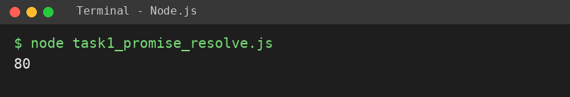
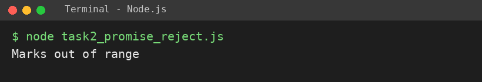
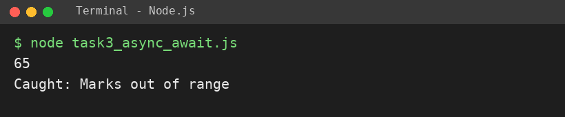
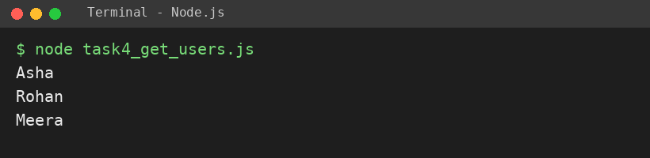

# EXPERIMENT NO. 15

**Name:** Pranay Kesarwani  |  **Roll No:** 2510303375

## 1. Experiment Title
Promises and async/await with Local Data

## 2. Aim
To create a Promise that resolves or rejects, use async/await with try and catch, and load local data as a Promise.

## 3. Software / Tools Required
JavaScript, Node.js, VS Code

## 4. Theory
A Promise represents a value that will be available later; it can resolve (success) or reject (error). .then handles success and .catch handles errors. async/await is cleaner syntax: await waits for a Promise inside an async function and try / catch handles rejections.

## 5. Algorithm / Procedure
1. Write checkMarks(marks) returning a Promise: resolve for 0-100, else reject Error("Marks out of range").
2. Call with 80 and print the value; call with 120 and print the error message.
3. Write async run() with try/await checkMarks(65) and checkMarks(-5); catch prints Caught: message.
4. Write getUsers() resolving after 100 ms with 3 users; an async function prints each name.
5. Run with: node each task file (tasks run one after another).

## 6. Program
**task1_promise_resolve.js**

```javascript
// Name: Pranay Kesarwani | Roll No: 2510303375 | Assignment: 15

function checkMarks(marks) {
  return new Promise((resolve, reject) => {
    if (marks >= 0 && marks <= 100) {
      resolve(marks);
    } else {
      reject(new Error("Marks out of range"));
    }
  });
}

checkMarks(80).then((value) => console.log(value));
```

**task2_promise_reject.js**

```javascript
// Name: Pranay Kesarwani | Roll No: 2510303375 | Assignment: 15

function checkMarks(marks) {
  return new Promise((resolve, reject) => {
    if (marks >= 0 && marks <= 100) {
      resolve(marks);
    } else {
      reject(new Error("Marks out of range"));
    }
  });
}

checkMarks(120).catch((err) => console.log(err.message));
```

**task3_async_await.js**

```javascript
// Name: Pranay Kesarwani | Roll No: 2510303375 | Assignment: 15

function checkMarks(marks) {
  return new Promise((resolve, reject) => {
    if (marks >= 0 && marks <= 100) {
      resolve(marks);
    } else {
      reject(new Error("Marks out of range"));
    }
  });
}

async function run() {
  try {
    console.log(await checkMarks(65));
    console.log(await checkMarks(-5));
  } catch (err) {
    console.log("Caught: " + err.message);
  }
}
run();
```

**task4_get_users.js**

```javascript
// Name: Pranay Kesarwani | Roll No: 2510303375 | Assignment: 15

function getUsers() {
  return new Promise((resolve) => {
    setTimeout(() => {
      resolve([
        { id: 1, name: "Asha" },
        { id: 2, name: "Rohan" },
        { id: 3, name: "Meera" },
      ]);
    }, 100);
  });
}

async function showUsers() {
  const users = await getUsers();
  users.forEach((u) => console.log(u.name));
}
showUsers();
```

## 7. Input
Marks 80, 120, 65, -5; users Asha, Rohan, Meera.

## 8. Output
**Task 1 (task1_promise_resolve.js)**

```
80
```



**Task 2 (task2_promise_reject.js)**

```
Marks out of range
```



**Task 3 (task3_async_await.js)**

```
65
Caught: Marks out of range
```



**Task 4 (task4_get_users.js)**

```
Asha
Rohan
Meera
```



## 9. Result
The experiment was performed successfully. The programs ran correctly and produced the expected output.

## 10. Viva-Voce Questions
1. **What is a Promise?**  
   Ans: An object for a value that will be available later (resolved or rejected).
2. **What does await do?**  
   Ans: Waits for a Promise to finish inside an async function.
3. **How are rejected Promises handled with async/await?**  
   Ans: With try / catch.
4. **What are the states of a Promise?**  
   Ans: Pending, fulfilled (resolved), rejected.
